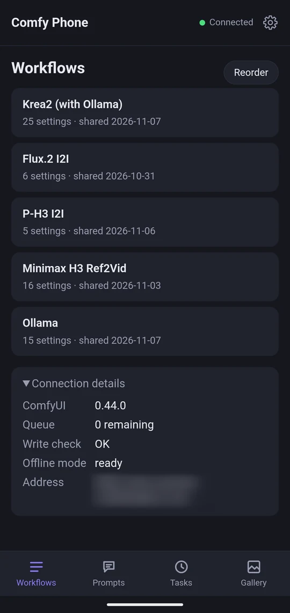
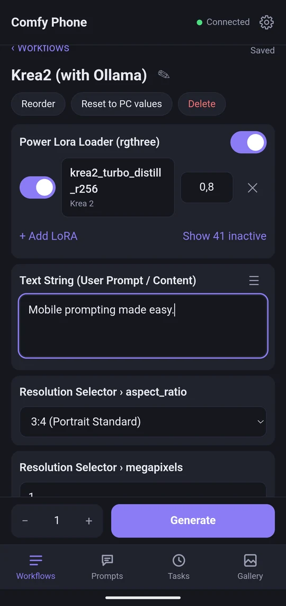
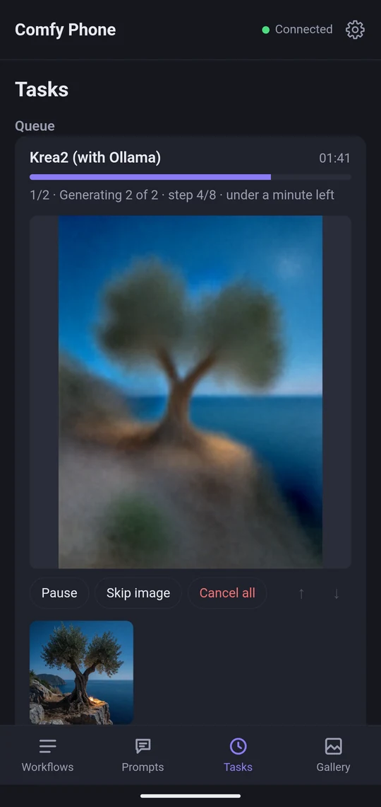
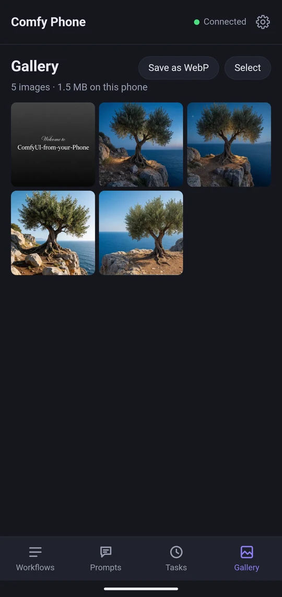
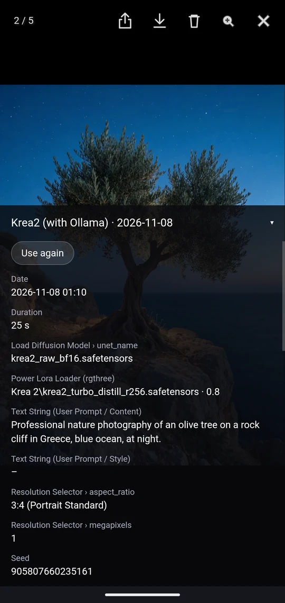
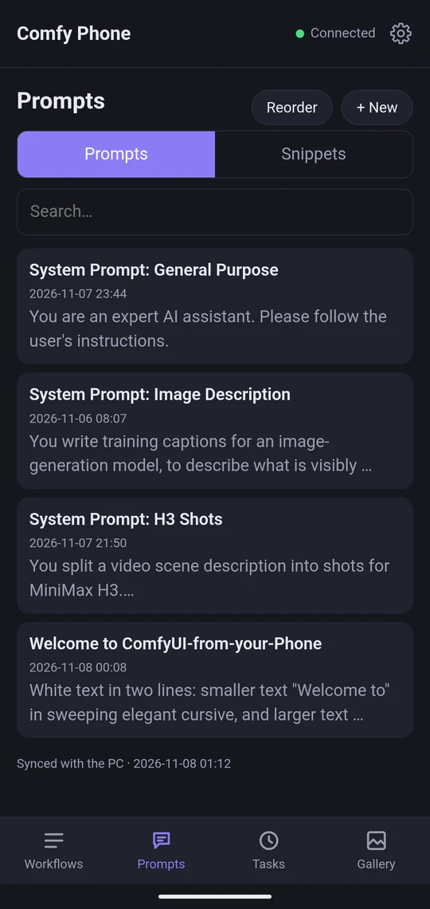
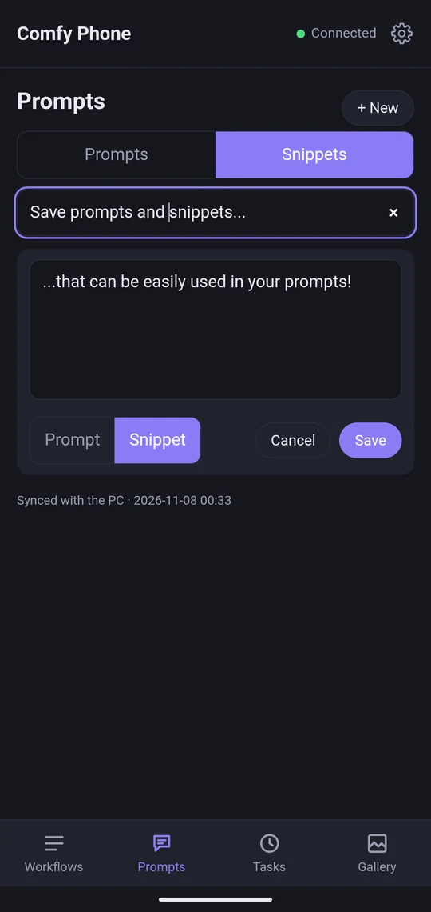
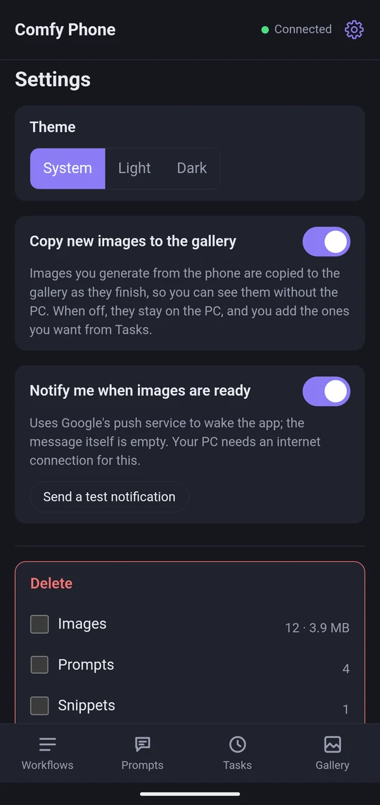
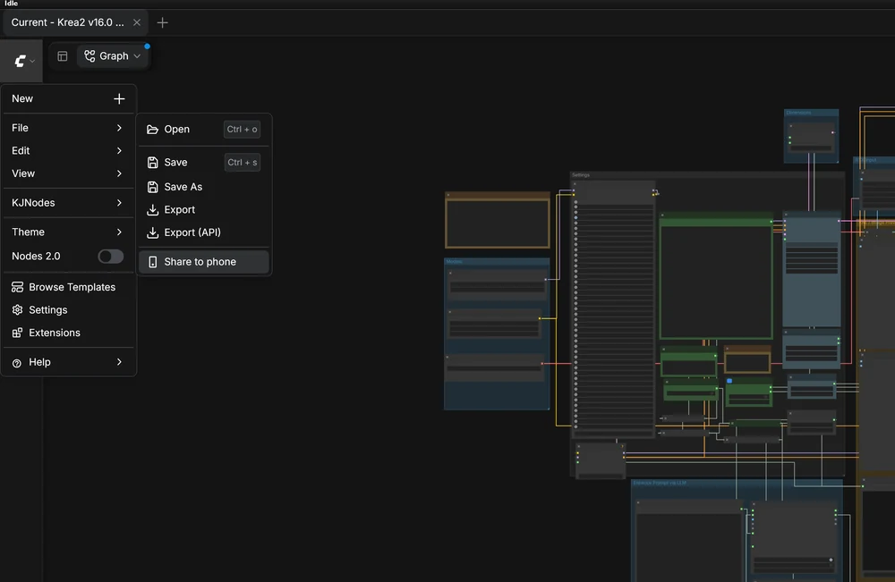
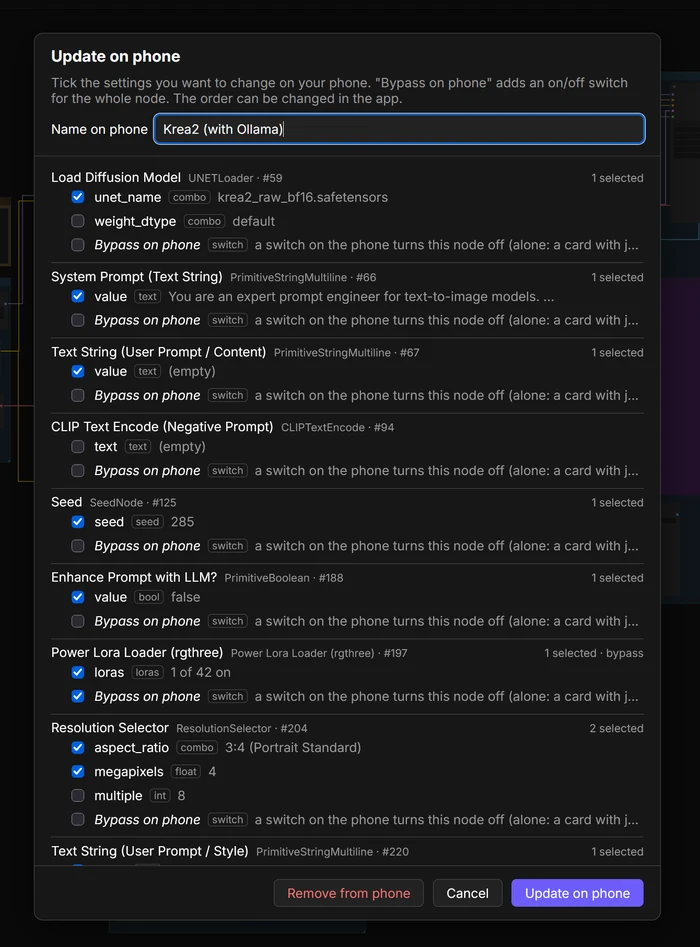

# ComfyUI from your Phone

**Your ComfyUI workflows, on your phone, wherever you are.**

Share a workflow from ComfyUI to your phone with one click, then change prompts and settings, queue images and
watch them render, wherever you are. The results land in a gallery on the phone. It all runs over your own private [Tailscale](https://tailscale.com) network: no cloud service, no account,
no subscription. Your images go from your PC to your phone and nowhere else.

<p align="center">
  
  
  
  
</p>

## Highlights

- **Generate from anywhere.** Write a prompt, pick your settings, tap **Generate**, and watch your image take
  shape, step by step, right on your phone.
- **Any workflow, as it is.** No extra nodes, no rebuilding. Open a workflow in ComfyUI, choose
  **File → Share to phone**, tick what the phone may change. Done.
- **Whatever it makes.** Images, videos, audio, even an LLM's answer.
- **Private.** No cloud, no account, no analytics, no cost. Just your PC and your phone, over your own tailnet.
- **The queue lives on the PC.** Queue a dozen images and put the phone away: closing the app or losing signal
  changes nothing.
- **A gallery on the phone.** Your results are copied to the phone as they finish, with the settings each one was
  made with. Swipe through them, save them, share them.
- **Prompts & snippets.** Keep your favourite prompts and building blocks in a library and drop them into any
  text field.

It is a ComfyUI custom node with the phone app built in. Nothing else to install on the PC.

<details>
<summary><b>Everything it does</b></summary>

**On the PC**
- **File → Share to phone** sends the open workflow to the phone, saved or not. A dialog lists every setting of
  every node; you tick the ones the phone may change. Prompts, seeds, sizes, models and LoRAs come pre-ticked.
- Also: widgets you exposed on a subgraph, notes on the canvas, on/off (bypass) switches for single nodes, and
  which text outputs the phone shows, in your order.
- Sharing the same workflow again updates it on the phone and keeps what you set there. Under a new name it
  becomes a second workflow on the phone (the dialog asks whether to remove the old one).

**Workflows**
- Text, numbers, switches, lists with search (models and LoRAs come live from the PC), seeds (random or fixed),
  Power Lora Loader rows, photos with a mask you paint with your finger, videos and audio (Load Video, Load Audio and
  the VideoHelperSuite's loaders). Take them from the phone, or pick one that's already on the PC: one list of
  ComfyUI's `input` and `output` folders, newest first, so the clip you just made is right at the top.
- Dynamic prompts like `{red|blue|green}` and `//` comments, rolled for each image as ComfyUI does.
- Reorder, rename, reset to the PC's values. Pick how many images, tap **Generate**.
- Works offline too: look at the workflows you opened on this phone before and change values; they go to the PC
  when it's back.

**Tasks**
- Progress, time left, a live preview. Pause, resume, skip an image, cancel, reorder.
- Text results (an LLM's answer, say) with Copy, Share and Save as prompt.

**Gallery**
- Images, videos and audio, viewable without the PC. Swipe and pinch-zoom.
- The settings each image was made with: its real seed, its roll of a dynamic prompt.
- **Use again** turns an image's settings into a new workflow, even after the workflow it came from was deleted.
- Save to the phone or share, as a small WebP or as the original file from the PC.

**Prompts & snippets**
- A library on the phone, backed up to the PC and shared between your devices. Search, reorder.
- The ☰ menu on every text field: save as prompt or snippet, load a prompt, insert snippets at the cursor.

**And**
- Optional notifications when your images are ready. Light and dark theme. Swipe between tabs.

<p align="center">
  
  
  
  
  
</p>

</details>

## Requirements

- ComfyUI on a PC (tested with ComfyUI portable on Windows).
- [Tailscale](https://tailscale.com) on the PC and on the phone (free for personal use).

### Recommended

- A phone browser that can install web apps (tested with Chrome on Android). The app then gets its own icon and
  the whole screen. A bookmark works too.
- For notifications: the Python packages `PyJWT` and `cryptography`. If you use ComfyUI-Manager, you already have
  them; otherwise see step 1 below.

## Installation

1. **The custom node.** In ComfyUI's `custom_nodes` folder:
   ```
   git clone https://github.com/the-aSak/ComfyUI-from-your-Phone
   ```
   (Or download the ZIP and unpack it there.) Restart ComfyUI. <!-- TODO: ComfyUI-Manager / Registry once listed -->

   Notifications need the Python packages `PyJWT` and `cryptography`. ComfyUI-Manager brings them along, so if
   you use it, you're set. Otherwise everything else works without them, and turning notifications on tells you
   they're missing. To install them, for ComfyUI portable, in its folder:
   ```
   python_embeded\python.exe -m pip install -r ComfyUI\custom_nodes\ComfyUI-from-your-Phone\requirements.txt
   ```
   Then restart ComfyUI.
2. **Tailscale.** [Install it](https://tailscale.com/download) on the PC and on the phone, signed in to the same
   account. Leave it on: only traffic to your own devices goes through it.
3. **HTTPS.** In the [Tailscale admin console](https://login.tailscale.com/admin/dns), keep MagicDNS on and
   click **Enable HTTPS** under *HTTPS Certificates*. The app needs an `https://` address: without one, the
   phone's browser won't install it, keep it ready offline or send notifications. (As Tailscale tells you there,
   your PC's name and your tailnet's name then appear in public certificate logs.)
4. **Share ComfyUI in your tailnet.** On the PC:
   ```
   tailscale serve --bg 8188
   ```
   8188 is ComfyUI's usual port. If you started ComfyUI with another `--port`, put that number there instead.
   This stays set up after restarts. It prints your address, like `https://my-pc.tail1234.ts.net/`. You also
   find it in the Tailscale app on the phone (tap your PC) or in the admin console.

   **ComfyUI itself needs no `--listen`**: Tailscale reaches it on the PC. If you use `--listen` for something
   else, keep 127.0.0.1 in (`0.0.0.0` does), because the app talks to ComfyUI there over plain HTTP. For the same
   reason, don't use `--tls-keyfile`.
5. **The app.** On the phone, open `https://my-pc.tail1234.ts.net/phone/` in Chrome. *Connection details* should
   say Connected. Then ⋮ → **Install app**.

### Your first workflow

Open a workflow in ComfyUI on the PC, choose **File → Share to phone**, and tick what you want to change. On the
phone, open it, change the prompt and tap **Generate**.

<p align="center">
  
  
</p>

## Before you start

- **Save your results.** The phone gets what the workflow **saves**: use **Save Image**, **Save Video** or
  **Save Audio** (other save nodes work too, as long as they write to ComfyUI's output folder), and text from
  nodes like *Preview as Text*. Preview Image alone keeps nothing; Tasks tells you so.
- **Supported formats:** PNG, JPG, WebP, GIF, MP4, WebM, MOV, MKV, MP3, WAV, FLAC, OGG, Opus, M4A. Videos and
  audio the phone's browser can't play stay on the PC; the app says so.
- **Sharing takes a snapshot.** The phone keeps running that version, even if you change or delete the workflow
  on the PC. For a workflow saved as a file, the list shows "changed" with the date, or "no longer saved on PC".
  Share it again to update the phone. A workflow only breaks where it would on the PC too: missing models,
  LoRAs, custom nodes or input images.
- **One person, several devices.** Two phones share workflows, tasks and prompts, and each one's gallery copies
  all images. Two PCs are two separate apps, each with its own address and data; *Connection details* says
  which one you're on.

## How it works

**The queue.** Tapping Generate hands the task to the PC, which works through it image by image. The phone only
looks in. The newest 100 finished tasks stay listed; older ones drop off, while their images stay in the gallery
and on the PC.

**The gallery keeps copies.** While the app is open, each new result is copied to the phone, including those
that finished while it was closed. Images become full-size WebP; videos and audio are copied as they are. The originals stay in ComfyUI's output folder. Deleting from the gallery removes only the
phone's copy, never the file on the PC. Copying can be turned off in Settings (⚙); then you add images from
Tasks yourself.

**Saving and sharing.** The switch at the top of the gallery chooses what **Save** stores:
- **WebP:** the small copy on the phone. Works offline, but it's the one file without ComfyUI's workflow
  inside: its settings are in the app.
- **Original:** the file from the PC, exactly as ComfyUI wrote it. A PNG keeps its workflow, to drop back into
  ComfyUI. A GIF stays animated, even though the gallery shows it as a still. When the PC can't be reached, or
  the file was deleted there, Save falls back to the WebP copy and tells you why.

**Share** always sends the copy on the phone, so it works offline too.

**Same settings, same file.** With a fixed seed, generating the same settings again gives the same image.
ComfyUI doesn't make it twice, so the gallery keeps one copy. If you delete it from the gallery, it doesn't
come back by itself: generate it again, or add it from Tasks while its task is still listed.

**Use again.** Each image remembers how it was made. **Use again** turns that into a new workflow, placed
below the one it came from. If that one was deleted, the new workflow goes to the end of the list.

**Offline.** Workflows you opened on this phone before can be viewed and changed without the PC. The changes
go to the PC when it's back. Generating needs the PC.

**Prompts & snippets.** The library belongs to the phones; the PC keeps a backup and passes changes on to your
other devices. When two devices change the same prompt, the newer change wins, by each device's clock.

### Where your data is

On the PC, in `ComfyUI/custom_nodes/ComfyUI-from-your-Phone/data/`. Back it up along with ComfyUI; deleting the
node's folder deletes it.

| | |
|---|---|
| `workflows/` | the shared workflows, one file each, with what you set on the phone |
| `workflow-order.json` | the order of the workflow list |
| `jobs.json` | the tasks |
| `prompts.json` | your prompts and snippets (the backup, and how they reach other devices) |
| `prompts.prev.json` | the version before, in case the file breaks (without the text of anything deleted) |
| `push.json` | the key and phones for notifications |
| `thumbs/` | preview images, emptied whenever ComfyUI starts |

Elsewhere on the PC: your images are in ComfyUI's `output` folder as always. Photos, videos and audio you pick on the phone are
uploaded to `input/phone` (with a copy for each painted mask) and stay there until you delete them. ComfyUI takes
uploads of up to 100 MB; start it with `--max-upload-size` to allow more, and the app follows.

On the phone, in the app's own storage: the gallery copies, the prompt library, and the workflows opened there.
The app asks Chrome to keep this storage, but Android may still clear it when space runs out, so save the images
you want to keep. Uninstalling the app, or clearing Chrome's data for the PC's address, deletes it.

## Troubleshooting

- **No "Install app" in Chrome's menu.** HTTPS isn't on yet (step 3), or you opened the address with `http://`.
  Open it with `https://`.
- **"Not connected".** Tailscale is off on the phone or the PC, ComfyUI isn't running, or `tailscale serve`
  isn't set up (`tailscale serve status` shows it).
- **No "Share to phone" in ComfyUI's File menu.** Restart ComfyUI after installing, then reload the ComfyUI page
  in the PC's browser.
- **Notifications don't arrive.** Check that the packages are installed (turning notifications on tells you).
  Android may also hold back notifications for apps it puts to sleep; allowing the app to run in the background
  in Android's battery settings helps.
- **A task fails.** The app shows ComfyUI's error. Usually it's what would fail on the PC too: a missing model,
  LoRA, custom node or input image.
- **The gallery stays empty.** The workflow needs a save node (see *Before you start*), and copying must be on
  in Settings (⚙). Images made in ComfyUI on the PC itself don't come to the phone; only tasks from the phone do.

## Updating

`git pull` in the node's folder (or unpack the new ZIP over it), then restart ComfyUI. The app on the phone
updates the next time you open it. Your data in `data/` stays.

## Uninstalling

1. Delete the node's folder in `custom_nodes`, then restart ComfyUI. This also deletes its `data/` folder.
   (Your images in `output`, and the uploads in `input/phone`, stay.)
2. `tailscale serve reset` on the PC stops sharing ComfyUI in your tailnet.
3. Uninstall the app on the phone. This deletes its gallery and prompt library.

## Security and privacy

- **No login of its own.** Whoever can reach your tailnet can use ComfyUI fully, with or without this app. The
  app doesn't open ComfyUI any wider than Tailscale already does. Web pages from elsewhere can't use it from
  your browser: ComfyUI refuses their requests (unless you start it with `--enable-cors-header`, which turns
  that check off).
- **Never use `tailscale funnel`** for this, only `tailscale serve`. Funnel puts ComfyUI on the public
  internet.
- **Sharing your PC with others** in Tailscale gives them full access to ComfyUI too.
- **The full ComfyUI interface** is reachable from the phone too, at the same address without `/phone/`. Better
  not open it in the phone's browser: the JavaScript of every custom node runs there and could read the app's
  gallery and prompts.
- **Collects no data.** No analytics, nothing sent anywhere but between your devices. The only exception is
  notifications: if you turn them on, the PC asks your browser maker's push service (Google's, for Chrome)
  to wake the phone, with an empty message. The phone then asks the PC itself what finished.

## Known limits

- **Made for one person, on as many devices as you like.** There are no separate users and no login of its own:
  everyone who gets in shares the same workflows, tasks and prompts. You can let others in through Tailscale,
  but they then get full access to ComfyUI too, which I don't recommend.
- **Tested on Android only.** iPhones and other browsers may work, but nobody has tried yet.
- **GIFs show as stills** in the gallery. Saved as the original, they stay animated.
- **Only tasks from the phone** reach the gallery, not what you generate in ComfyUI on the PC.
- **Copies from Use again of a deleted workflow** carry no drawing of the canvas. Their PNGs still hold the
  workflow, but ComfyUI lays its nodes out in a plain grid.
- **Only the newest 100 finished tasks** stay in the list. The gallery keeps everything until you delete it.

## Tested with

Pixel 8a, Chrome (installed as an app), Google's own keyboard (Gboard); ComfyUI 0.44 portable on Windows 11.
If something doesn't work for you, please open an issue.

## Contributing

Issues, bug reports and ideas are welcome. This is a one-person project, so pull requests may not be merged.

## License and credits

GPL-3.0, like ComfyUI. Includes [PhotoSwipe](https://photoswipe.com) (MIT, see `app/vendor/LICENSE-photoswipe.txt`).

Built with the help of AI (Claude by Anthropic).

Not affiliated with or endorsed by Comfy Org / ComfyUI or Tailscale. ComfyUI is a registered trademark of its
owner.

Provided as is, without warranty, as the GPL-3.0 says. As with any software: keep backups of what matters to you.
